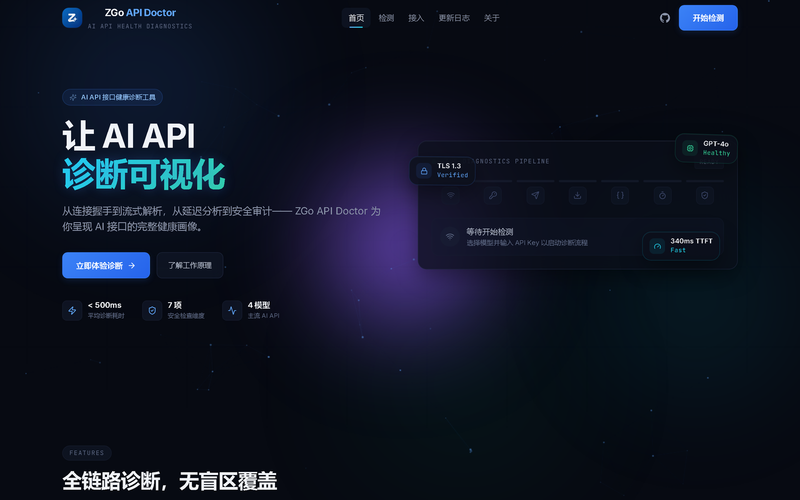
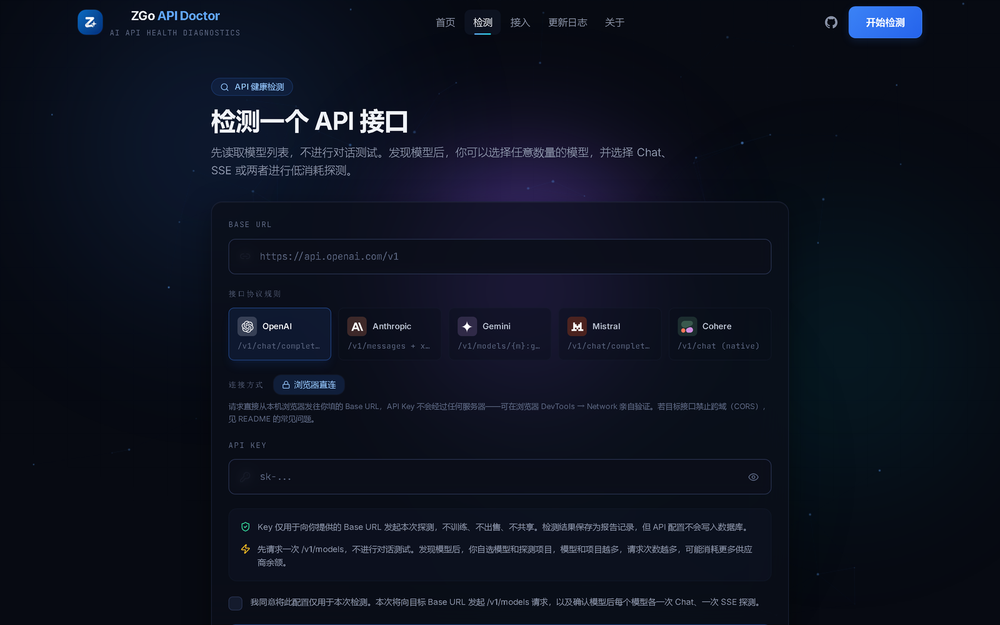
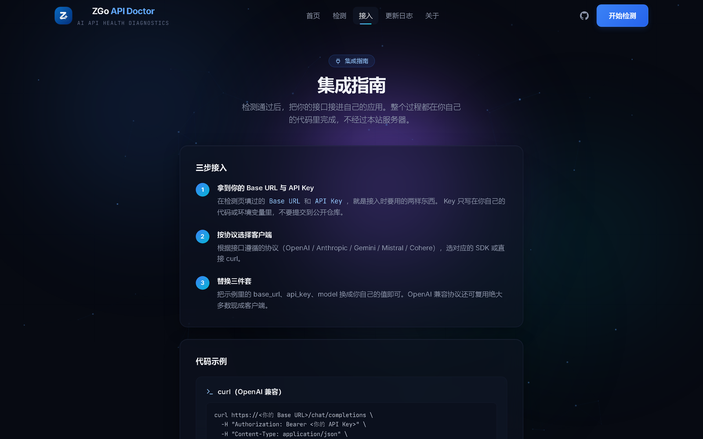

# ZGo API Doctor

**Find out whether an AI API endpoint actually works — in your browser.**

Paste a Base URL and an API key. The tool lists the models, sends one real chat request and one SSE streaming request per model, then produces a diagnostic report with an A/B/F grade and a 0–100 health score.

**No hosted instance.** This is a pure static frontend: `npm install && npm run dev` and it runs locally. Every request goes straight from your browser to the endpoint you typed — **running it yourself is exactly equivalent to using a hosted copy**. See [Getting started](#getting-started).

> **Your API key never leaves the browser.** Every request is a plain `fetch()` from the page to the Base URL you entered. Open DevTools → Network and confirm yourself: no request goes to any third-party domain.



<p align="center">
  
  
</p>

<p align="center">
  <sub>Left: the detect page — Base URL, key, protocol, probes, all in the browser ｜ Right: the integration guide — how to wire a passing endpoint into your code</sub>
</p>

---

## Contents

- [Why you need it](#why-you-need-it)
- [Features](#features)
- [Getting started](#getting-started)
- [How it works](#how-it-works)
- [Scoring](#scoring)
- [Supported protocols](#supported-protocols)
- [FAQ](#faq)
- [Project layout](#project-layout)
- [Further reading](#further-reading)
- [License and brand boundary](#license-and-brand-boundary)

---

## Why you need it

When you use an AI API reseller or proxy, the usual problems are: the model list looks complete but some models simply do not respond; latency swings wildly; a stream dies halfway through. It is very hard to tell from "just try again" whether the problem is the provider or your own code.

This tool turns "does the endpoint work" into something quantifiable, screenshot-able and shareable — **without handing your key to anyone**.

## Features

| Feature | Description |
|---|---|
| **Zero-trust probing** | Requests go from the browser straight to the target endpoint; the key only ever appears in the request header sent to that provider. See [`src/lib/probeDirect.ts`](./src/lib/probeDirect.ts) |
| **Model discovery** | Calls `/v1/models` to pull the catalogue without spending quota; search, filter, bulk select |
| **Chat + SSE double probe** | Per model, optionally run a normal chat request and a streaming one, recording time-to-first-byte (TTFT) and chunk count |
| **A/B/F grading** | Both probes pass = A; one passes = B; both fail = F |
| **Health score** | A single 0–100 value, so several providers can be compared side by side |
| **Pre-flight panel** | Before probing, expand to see every request that will be sent (URL / headers / body), with the key redacted |
| **Shareable report** | The report is encoded into the URL hash — no server needed (`#/report?d=...`) |
| **Export** | One click to export a self-contained HTML report that opens offline |
| **Integration templates** | Generates cURL / Python / Node snippets plus common agent-tool configs per protocol |

## Getting started

Requires Node.js 18+.

```bash
npm install
npm run dev      # http://localhost:5173
```

Production build:

```bash
npm run build    # output in dist/, pure static, deployable to any static host
npm run preview  # preview the build locally
```

Other commands:

```bash
npm run typecheck   # tsc --noEmit
npm run lint        # eslint
```

> This is a **pure static frontend**: no backend, no database, no accounts. Drop `dist/` on any static host (Vercel / Netlify / Nginx / object storage) and it runs.

## How it works

Three modules, all executed in the browser:

```
src/lib/probeDirect.ts    probe engine: discover models → probe each model → aggregate score
src/lib/mappers.ts        maps probe results into the report structure (pure functions)
src/lib/share.ts          report ↔ URL token encoding (frontend only)
```

A full probe run:

```
1. Discover models   GET  {base}/models            → model id list, no chat request sent
2. Probe each model  POST {base}/chat/completions  → normal chat, record latency and response
                     POST {base}/chat/completions  → stream:true, record TTFT and chunk count
3. Aggregate         weighted average of healthy / degraded → score + A/B/F grade
```

**The key point: every step is a `fetch()` straight to the domain you entered.** Open DevTools → Network and every request Host will be your own provider — none of them third-party.

Timeout policy (see `probeDirect.ts`):

| Stage | Timeout |
|---|---|
| Model discovery | 8s |
| Per-model probe (chat / SSE) | 12s |
| Model count cap | 100 |

## Scoring

Each model gets one of three grades:

| Grade | Condition |
|---|---|
| **A** | Both chat and SSE probes succeed |
| **B** | Only one succeeds |
| **F** | Both fail |

The total score is a weighted average:

```
score = round( (healthy × 100 + degraded × 65) / models_probed )
```

So a report where every model is A scores 100; if more than half are B, the score drops noticeably. The point of the formula is to **fold "does it work" and "does it work smoothly" into one comparable number**, so you can rank several resellers against each other.

> The score reflects a **single observation at generation time**. 100 does not mean it is stable long-term, and a low score may just be a transient hiccup — which is why the tool also keeps the raw latency and TTFT for every model, so you can judge for yourself.

## Supported protocols

Five built-in protocol templates handle path and auth differences automatically:

| Protocol | Path | Auth |
|---|---|---|
| OpenAI | `/v1/chat/completions` | `Authorization: Bearer <key>` |
| Anthropic | `/v1/messages` | `x-api-key` + `anthropic-version` |
| Gemini | `/v1/models/{model}:generateContent` | `x-goog-api-key` |
| Mistral | `/v1/chat/completions` | `Authorization: Bearer <key>` |
| Cohere | `/v1/chat` | `Authorization: Bearer <key>` |

Aliases are normalised automatically (`claude` → `anthropic`, `google` → `gemini`, `command` → `cohere`).

## FAQ

**Q: The browser throws a CORS error. What now?**

This is by far the most common issue. Browsers require the target endpoint to return an `Access-Control-Allow-Origin` response header, and many API providers do not send one by default — they are built for server-side callers, not browsers.

Three options:

1. **Use a provider that supports CORS.** Most services aimed at end users enable it, because they know people may call them from web tools.
2. **Add CORS headers on the endpoint** if you control it.
3. **Run a local reverse proxy** so the cross-origin call becomes same-origin, for example:

   ```js
   // vite.config.ts — use Vite's proxy in development
   server: {
     proxy: {
       '/proxy': {
         target: 'https://your-provider.com',
         changeOrigin: true,
         rewrite: (p) => p.replace(/^\/proxy/, ''),
       },
     },
   }
   ```

   ⚠️ Note: **once a proxy is in the path, your key passes through the proxy machine** and the zero-trust premise no longer holds. Make sure you trust that machine. This project deliberately ships no built-in proxy mode, precisely so that this path is not opened by accident.

**Q: Does probing consume my quota?**

Yes. Every chat and SSE probe is a real request. Before starting, the tool shows "this run will send N requests" and clamps `max_tokens` down to 16 to limit the cost. Reading the model list (`/v1/models`) normally costs nothing.

**Q: Some model shows F, but I can use it elsewhere. Why?**

Common causes: the provider has not implemented streaming for that model, or the model's request format deviates from the OpenAI standard. The report's "error code" and "response preview" fields show the concrete reason.

**Q: Are only these five protocols supported?**

For now, yes. If your provider is OpenAI-compatible — which almost every reseller is — just pick the OpenAI protocol.

**Q: Is any data uploaded anywhere?**

No. There is no backend, no telemetry, no analytics SDK. Form drafts live in browser `localStorage`, and a shared report is encoded into the URL itself.

## Project layout

```
src/
├── lib/
│   ├── probeDirect.ts    ⭐ probe engine (the zero-trust core)
│   ├── mappers.ts            probe results → report
│   ├── share.ts              report share encoding
│   ├── session.ts            form drafts (localStorage)
│   ├── site.ts               ⚠ site constants (placeholders — replace when forking)
│   └── api.ts                protocol type definitions for probing
├── pages/
│   ├── DetectPage.tsx        main detect flow
│   ├── IntegrationPage.tsx   integration docs
│   └── ...                   home / about / changelog / privacy / terms / report
├── components/               home sections and shared components
│   ├── TechDetails.tsx       how the internals work
│   ├── KeyZeroTrust.tsx      zero-trust proof from the source
│   └── ...
├── router.ts                 hash router
└── App.tsx
```

The app has **no backend**: `lib/api.ts` keeps only the types and helpers needed for probing. Everything else — accounts, payments, admin, key vault — has been removed from the open-source build.

## Further reading

- [docs/platform-diagnosis.md](./docs/platform-diagnosis.md) —
  *Telling "the platform is down" apart from "you can't reach it"*: a layered method for diagnosing AI API platform availability.
  It covers how to distinguish three very different failures — the provider is down, the domain is blocked, DNS is poisoned — with implementation you can lift directly. The document does not depend on this codebase and can be read on its own.

## License and brand boundary

Released under **AGPL-3.0-only** — see [LICENSE](./LICENSE) and [NOTICE.md](./NOTICE.md).

AGPL rather than MIT on purpose, because it contains a clause that matters for network services:

> **§13** — If you modify this program and make it available to users over a network, you must offer those users the complete corresponding source of your modified version.

In other words: **commercial use is fine, but if you change it you have to publish it.** That closes off "take the open-source code, rename it, ship it as a closed SaaS".

To be explicit: **a copyright licence is not a trademark licence. The "ZGo" name and marks are not covered by AGPL** and may not be used without permission. The full boundary and a fork checklist are in [NOTICE.md](./NOTICE.md).

---

*A separate sister project applies the same method to diagnose **third-party platforms** for DNS poisoning and TLS blocking — a server-side job. The methodology is written up as a long-form technical article.*
